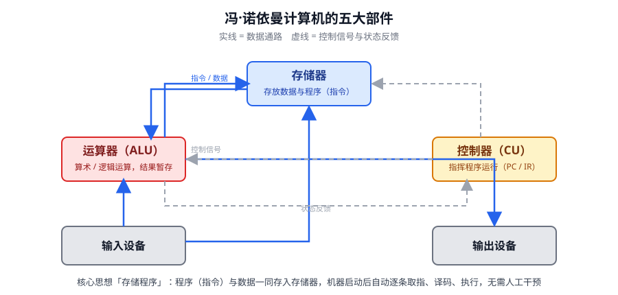
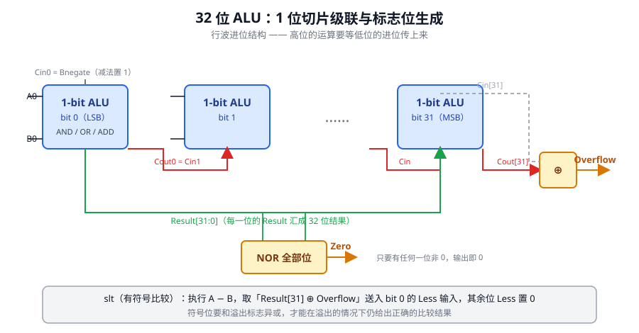

本讲是全课程的地图：先回答「什么是计算机体系结构」，再从冯·诺依曼结构出发补齐运行机理、程序计数器、性能指标、数的表示和简易 ALU 这几块地基。后续三讲的所有内容——流水线、乱序执行、计分板、Tomasulo——都要反复用到这里的概念。

::: tip 全课程知识框架
课程主体分四大块：**处理器核心**（单周期 → 多周期 → 流水线 → 乱序执行：超标量、计分板、寄存器重命名、分支预测）、**存储层次**（高速缓存结构与一致性、内存与虚拟内存）、**并行与系统**（多线程多核、向量与 GPU、片上网络、仓库级计算与云计算）、**评价与专题**（基准测试、性能分析、硬件安全与虚拟化、AI 加速）。复习时按这条主线组织，单讲知识不会悬空。
:::

## 1 体系结构、组成与微体系结构

计算机体系结构是描述计算机各组成部分及其相互关系的一组规则和方法，是**程序员所看到的计算机属性**。它包含两个层次：

- **指令系统结构（ISA）**：软件与硬件之间的分界面，规定指令格式、寄存器、寻址方式、异常处理等「契约」；
- **计算机组织结构**：满足该契约的具体实现。其中微处理器的组织结构称为**微体系结构（μArch）**，并行计算机的组织结构称为并行体系结构。

一个 ISA 可以对应许多种微体系结构——x86 指令集背后既有顺序单发射的实现，也有乱序超标的实现；这正是体系结构这门课的核心命题：**同一份 ISA 契约下，如何设计出更快的实现**。冯·诺依曼结构的存储程序与指令驱动执行原理，是这一切现代设计的共同起点。

## 2 冯·诺依曼结构与存储程序

ENIAC 的编程要靠手工插线、设置开关，换个题目就得重新接线数小时——机器本身极快，准备工作极慢。改进思路是「任务清单」：把要做的事写成程序，与数据一起送进机器内部存储，机器启动后自动逐条取指令、执行指令，全程不需要人干预。这就是**存储程序**（Stored Program）思想。

由这一思想推出的机器就是冯·诺依曼结构，它有五条要点，逐条都能对应到硬件：

1. 计算机由**运算器、控制器、存储器、输入设备、输出设备**五个部件组成；
2. 存储器既存数据也存指令，形式上无区别，但机器必须能区分二者（靠取指/访存的时机与来源区分）；
3. 控制器能自动执行指令（自动取指-译码-产生控制信号）；
4. 运算器能做加减乘除与基本逻辑运算；
5. 指令与数据均以二进制表示，指令由**操作码 + 地址码**组成。

理解这张图的关键在连线：实线是数据流，虚线是控制流与状态反馈。**控制器是指挥者，但数据不经过控制器**——它只发出命令；运算器算完的结果写回存储器，输出设备只是数据通路的末端。

## 3 控制器三件套：PC、IR、CU

存储程序如何「自动」运转？答案是控制器里的三个部件：

- **PC（Program Counter，程序计数器）**：存放**当前欲执行指令的内存地址**，并具有计数功能——取指之后 (PC) + 1 → PC，指向下一条指令；
- **IR（Instruction Register，指令寄存器）**：存放**当前正在执行的指令本身**，供译码；
- **CU（Control Unit，控制单元）**：根据 IR 中的指令产生控制信号序列。

一条指令的执行分三步：**取指（含译码）→ 分析 → 执行**，周而复始。「+1」的 1 表示一条指令的长度：内存按字节编址时，32 位指令字长的机器实际做的是 **PC ← PC + 4**。PC 体现了存储程序概念的精髓——指令的位置是一个普通的数，可以被计算、被修改，这是后来分支、跳转、函数调用乃至返回地址攻击防护的硬件根源。

## 4 性能：指标、时钟与三大定律

### 4.1 主要技术指标

- **机器字长**：CPU 一次能处理的数据位数，与寄存器位数一致；
- **运算速度**：常用 **MIPS**（每秒百万条指令）、**CPI**（每条指令的时钟周期数，其倒数 IPC 表示每周期指令数）、**FLOPS**（每秒浮点运算次数）；对混合指令流还可用吉普森法按各类指令的使用比例加权求平均执行时间。

最核心的公式是：

**CPU 时间 = 指令数 IC × CPI × 时钟周期**

三个因子来源不同：**IC 由编译器与 ISA 决定，CPI 与时钟周期由处理器的设计实现决定**。后两讲的一切优化（流水线降 CPI 的上限、前递消除停顿、乱序执行填空泡）都是在这两个因子上做文章。

### 4.2 时钟与关键路径

数字硬件由恒定频率的时钟驱动。寄存器到寄存器之间隔着组合逻辑，信号必须在一个周期内走完**延迟最长的那条路径（关键路径）**，所以**时钟频率由关键路径延迟决定**：4.0 GHz 即周期 250 ps。这个结论直接解释了单周期处理器的困境（第 2 讲）——把一条指令的全部工作塞进一个周期，周期必然被最慢的 lw 拉长。

### 4.3 三大定律

- **摩尔定律**：集成电路上可容纳的晶体管数目约每两年翻一番，成本几乎不涨。它是几十年来「晶体管预算不断变多」这一前提的来源；
- **登纳德缩放（Dennard Scaling）**：晶体管尺寸缩小时功率密度基本不变——晶体管又多又省电的好日子。它的失效（约 2005 年起）直接导致主频停滞，行业转向多核与专用加速；
- **阿姆达尔定律**：用某种更快的执行方式获得的加速比，受「可加速部分所占时间比例」限制——**性能被短板封顶**。它是评价一切并行化方案（包括多核、GPU）收益上限的标尺。

::: warning 易混淆点
登纳德缩放管的是**功耗密度**（每单位面积功耗不变），摩尔定律管的是**晶体管数量**。二者经常一起提但说的不是一件事；「主频不再上涨」的直接推手是前者失效。
:::

## 5 数的表示与运算

### 5.1 无符号数与机器数

n 位无符号数的表示范围是 0 ～ 2^n^−1（8 位即 0 ～ 255），常用于地址与编号。有符号数引入**真值**（带符号的数）与**机器数**（符号数字化的数）之分。

### 5.2 原码与补码

**原码**是带符号的绝对值表示：最高位为符号位（0 正 1 负），数值位就是绝对值，如 x = −1110 时 [x]原 = 1,1110。直观，但加减法要单独处理符号，硬件不友好。

**补码**（Two's Complement）是实际采用的标准。负数的补码有一个快捷求法：**原码除符号位外每位取反，末位加 1**。例如 x = −1010，[x]原 = 1,1010，取反加一得 [x]补 = 1,0110。补码的妙处在于减法可以完全转化为加法：**A − B = A + B 按位取反 + 1**，于是加减法共用同一套加法器——这是第 6 节 ALU 里 Bnegate 信号的来历。

## 6 算术逻辑单元 ALU

ALU 是指令执行的运算核心。设计思路是自底向上的：先做 1 位切片，再级联成 32 位。

**1 位 ALU** 包含 AND、OR、加法器三个单元和一个多选器，由两位控制信号选择输出。要支持减法，只需给加法器的 B 输入加一个 **Bnegate**（或 Cin）通路：Bnegate = 1 时送入的是 B 的按位取反，同时最低位进位为 1，恰好等价于上一节的 A + B 按位取反 + 1。

**32 位 ALU** 由 32 个 1 位切片级联而成，进位从低位向高位逐位传播（行波进位）。在级联结构上挂三个标志逻辑：

- **Overflow（有符号溢出）**：Overflow = CarryIn(MSB) ⊕ CarryOut(MSB)——最高位的进位输入与进位输出不一致，说明结果符号翻转了（两个正数相加得负、两个负数相加得正）；
- **Zero**：把 32 位结果全部送入一个**大 NOR 门**，任何一位非零输出即为 0。beq 指令的比较就靠它；
- **slt（set on less than）**：做一次减法 A − B，若结果为负则置低位为 1。细节在于**结果符号位要与 Overflow 异或后**才送入最低位切片的 Less 输入——发生溢出时符号位是「反」的，必须纠正。

::: warning Overflow 与 CarryOut 的区别（高频考点）
**Overflow** 是给**有符号数**用的：结果符号与操作数符号预期不符（正 + 正 = 负，负 + 负 = 正）时置位。**CarryOut** 是给**无符号数**用的：加法结果小于被加数（有进位）或减法结果大于被减数（有借位）时置位。同一次运算，两个标志各自独立判定，互不冲突；非加减运算时二者均未定义。
:::

## 7 指令系统：软硬件的交界

**机器指令**是每一条机器语言的语句；**指令系统**是全部机器指令的集合，反映机器的全部功能。指令系统处在软/硬件交界面上，被硬件设计者与系统程序员同时看到：设计者要确定并用硬件实现它，使用者（系统程序员）依据它编写汇编程序——而且只有熟悉硬件实现，才能写出高效的代码。指令系统设计的好坏直接决定计算机的性能与成本，因此体系结构的第一性问题从来都是「ISA 定成什么样，实现才能既简单又快」。

## 8 小结与自测

- 体系结构 = ISA + 组织结构；ISA 是软硬界面，微体系结构是处理器的组织；
- 存储程序：指令与数据同存于存储器，PC 驱动自动逐条执行，PC ← PC + 4；
- CPU 时间 = IC × CPI × 周期；周期由关键路径决定；摩尔定律（晶体管）、登纳德缩放（功耗密度）、阿姆达尔定律（短板封顶）；
- 补码使减法变加法；32 位 ALU 由 1 位切片级联，Overflow 用最高位进位异或检测，Zero 用 NOR 检测，slt 的符号位要再与 Overflow 异或；
- 指令系统 = 机器指令的全集，软硬件在此分界。

自测题：① 为什么说「时钟频率由关键路径延迟决定」？② 用补码快捷法求 −1011000 的补码并验算。③ 两个无符号数相加发生进位时，Overflow 会置位吗？为什么？④ 登纳德缩放失效如何推动体系结构转向多核？

## 参考资料

- [国科大计算机学院课程主页（180086085404P2008Y 计算机体系结构）](https://admission.ucas.ac.cn/)
- 课件：《L01-课程概要与体系结构基础》（国科大，主讲教师高婉铃；素材致谢胡伟武《计算机体系结构》、UC Berkeley CS152/CS61C、ETHz Onur Mutlu、P&H《计算机组成与设计》《计算机体系结构：量化研究方法》等）
- [MIT 6.191 Computation Structures](https://6191.mit.edu)、[CMU 18-447 Introduction to Computer Architecture](https://users.ece.cmu.edu/~jhoe/doku/doku.php?id=18-447_introduction_to_computer_architecture)、[Berkeley CS61C](https://cs61c.org)、[Berkeley CS152](http://www-inst.eecs.berkeley.edu/~cs152/sp23/)
