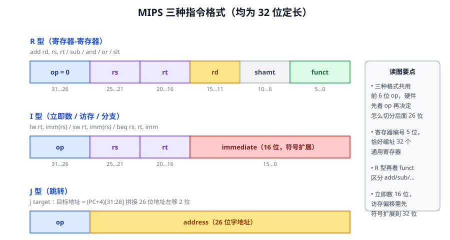
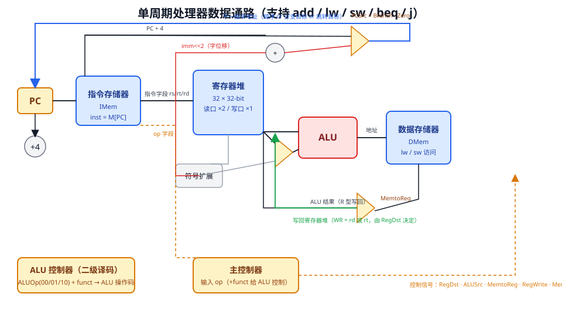

本讲名义上是「复杂流水线」系列的开篇，实际任务是打地基：先把 ISA 层面的数据表示、寻址方式、MIPS 指令格式讲清楚，再把一个支持 9 条指令的**单周期处理器**从数据通路到控制器完整搭出来。它是后续多周期、流水线两条路线的参照物。

## 1 数据的存储与排列顺序

80 年代以来几乎所有通用机器都按**字节编址**。那么一个 32 位的字占据 4 个连续字节，ISA 必须回答两个问题：字节顺序怎么排？字能否放在任意地址？

**大小端（Endianness）**：设字地址为 100，

- **小端（Little Endian）**：数的地址上存放的是 **LSB**。代表：Intel 80x86、DEC VAX；
- **大端（Big Endian）**：数的地址上存放的是 **MSB**。代表：IBM 360/370、Motorola 68k、SPARC、HP PA；
- ARM、MIPS 两种都支持，由控制位设定。

::: tip 记忆方法
小端 =「低位在低位地址」，像数字书写反过来；大端 =「高位在低位地址」，与人书写顺序一致。int i = −65535 的补码是 0xFFFF0001H：小端机器从 100 号单元逐字节读到 01 00 FF FF，大端机器读到 FF FF 00 01——同一个数，两种读法，跨机器传数据时必须统一约定（网络字节序即大端）。
:::

**边界对齐**：字地址应是 4 的倍数（半字地址是 2 的倍数）。对齐让一次访存必能取出一个完整字，代价是空间略有浪费；不对齐则可能一次访存跨两个存储周期，硬件处理复杂。

## 2 数据寻址方式

设 A 为指令地址字段值，R 为寄存器编号，EA 为有效地址，(X) 表示 X 的内容：

| 方式 | 有效地址/操作数 | 主要优点 | 主要缺点 |
| --- | --- | --- | --- |
| 立即 | 操作数 = A | 执行快，不用访存 | 数值范围有限 |
| 直接 | EA = A | 计算简单 | 寻址范围有限 |
| 间接 | EA = (A) | 寻址范围大 | 多次访存 |
| 寄存器 | 操作数 = (R) | 快且指令短 | 地址范围有限 |
| 寄存器间接 | EA = (R) | 范围大 | 额外一次访存 |
| 偏移 | EA = (R) + A | 灵活 | 稍复杂 |
| 堆栈 | EA = 栈顶 | 指令短 | 应用面窄 |

偏移寻址是「直接 + 寄存器间接」的组合，按寄存器的用途分为**基址、变址、相对**（PC）三种；MIPS 不作区分，统一为偏移寻址。

## 3 MIPS ISA：格式、寄存器与约定

MIPS 的名字是「无内部互锁流水级的微处理器」（Microprocessor without Interlocked Piped Stages）——这个名字把流水线互锁的担子交给了编译器，第 3 讲会再回到这一点。要点：

- 所有指令 **32 位定长**；
- 32 个 32 位通用寄存器（r0 恒为 0）、32 个浮点寄存器，以及 HI、LO、PC 等专用寄存器；
- 只有 **load/store 指令能访问存储器**，数据地址 = 32 位寄存器内容 + 16 位带符号偏移（需符号扩展），数据要求边界对齐。

三种格式是考场的常客。共同规律：**前 6 位 op 先行译码，决定剩余 26 位的切分方式**；R 型还要再看 funct。寄存器编号 5 位恰好编址 32 个寄存器。

MIPS 的 32 个寄存器有严格的软件约定（`$0`~`$31` 或按名引用）：

| 名称 | 编号 | 用途 | 调用是否需保存 |
| --- | --- | --- | --- |
| zero | 0 | 恒 0 | — |
| at | 1 | 汇编器保留 | — |
| v0–v1 | 2–3 | 返回值 | 否 |
| a0–a3 | 4–7 | 参数 | 是 |
| t0–t7 | 8–15 | 临时变量 | 否 |
| s0–s7 | 16–23 | 被调用者保存 | 是 |
| t8–t9 | 24–25 | 临时变量 | 否 |
| k0–k1 | 26–27 | 内核保留 | — |
| gp / sp / fp / ra | 28–31 | 全局指针 / 栈指针 / 帧指针 / 返回地址 | 是 |

## 4 处理器设计：数据通路与控制器

CPU 只有两大部分：

- **数据通路（Datapath，"肌肉"）**：指令执行过程中数据流经的路径与部件，核心是 ALU、寄存器堆、存储器及其间的连线；
- **控制部件（Control Unit，"大脑"）**：对指令译码，生成控制信号，指挥数据通路动作。

性能视角下，二者设计直接决定**时钟周期**与 **CPI**——回到上一讲的公式，IC 定了之后，剩下的优化全在这里。设计流程五步，贯穿本讲与下一讲：

1. 分析指令集，用 **RTL**（寄存器传送语言）描述每条指令的功能；
2. 选定数据通路元件与时钟方案；
3. 组装数据通路；
4. 分析每条指令的实现，确定控制信号取值，列出「指令 × 控制信号」关系表；
5. 由表写出逻辑表达式，设计控制器电路。

### 4.1 两类元件

- **组合逻辑**：输出只由当前输入决定（与门、加法器、多选器、ALU）；
- **状态元件（存储元件）**：按时钟边沿更新。**寄存器**带写使能（Write Enable = 1 且时钟沿到来才写入）；**寄存器堆**是 32 个寄存器 + 2 个读口 + 1 个写口，读口经多选器（对 32 个寄存器做 32 选 1）实现，写口由 5 位 WR 编号 + RegWrite 信号控制；**存储器**读操作如同组合逻辑（地址有效后经短暂访问时间数据即有效），写操作则在时钟沿进行。

## 5 逐条搭建数据通路

以 9 条指令为目标：add、sub、and、or、slt、lw、sw、beq、j。

- **R 型** `R[rd] ← R[rs] op R[rt]`：rs/rt/rd 三个字段分别接读口 1、读口 2 与写口编号；ALU 操作由译码决定；RegWrite = 1；
- **lw** `R[rt] ← Mem[R[rs] + SignExt(imm16)]`：基址来自 rs，符号扩展的 16 位偏移与 R[rs] 在 ALU 相加得访存地址，读出的数据写回 rt；
- **sw** `Mem[R[rs] + SignExt(imm16)] ← R[rt]`：与 lw 相似，只是数据流向存储器，rt 提供写入数据；
- **beq**：读出 rs、rt 送 ALU 做减法看 Zero；同时符号扩展、左移 2 位（指令里的偏移是**字位移**）加到 **PC+4** 上得到分支目标；用 MUX 在 PC+4 与分支目标间选择，选择信号 **PCSrc = Branch · Zero**；
- **j**：目标地址 = (PC+4) 高 4 位 ∥ 26 位地址 ∥ 00（跳转目标是**字地址**，最低两位恒 0），需要额外的 jump 控制信号与多选器。

数据通路里有三处关键 MUX：**RegDst**（写口用 rd 还是 rt）、**ALUSrc**（ALU 第二操作数来自寄存器还是符号扩展立即数）、**MemtoReg**（写回数据来自存储器还是 ALU），加上 **PCSrc** 和 jump 选择器，它们的选择信号正是控制器的主要输出。

::: info 补充：分支延迟槽
MIPS 体系结构规定跳转指令后面的一条指令**无论分支是否发生都会执行**，这个位置称为分支延迟槽（branch delay slot）。它是给早期没有分支预测的流水线准备的：分支目标第 2 级才确定，取指级不能闲着，索性让这条指令「总是执行」来填补气泡。现代实现靠分支预测已不需要它，但 MIPS、SPARC 为了软件兼容保留至今。
:::

## 6 控制器设计

单周期控制器的输出在整个周期内保持不变，所以它就是**纯组合逻辑**：列出真值表，直接化简成电路。控制器分两级，减小主控规模：

**主控制器**输入 op（6 位），输出各路控制信号。九条指令的标准真值表：

| 指令 | RegDst | ALUSrc | MemtoReg | RegWrite | MemRead | MemWrite | Branch | ALUOp |
| --- | :-: | :-: | :-: | :-: | :-: | :-: | :-: | :-: |
| R 型 | 1 | 0 | 0 | 1 | 0 | 0 | 0 | 10 |
| lw | 0 | 1 | 1 | 1 | 1 | 0 | 0 | 00 |
| sw | × | 1 | × | 0 | 0 | 1 | 0 | 00 |
| beq | × | 0 | × | 0 | 0 | 0 | 1 | 01 |
| j | jump 信号单独由 op 译码产生 | | | | | | | |

**ALU 控制器**输入 ALUOp 与 R 型的 funct 字段，输出 3 位 ALU 操作码：ALUOp = 00（访存）→ 010 加法；01（分支）→ 110 减法；10（R 型）再查 funct——100000 加 → 010，100010 减 → 110，100100 与 → 000，100101 或 → 001，101010 slt → 111。

## 7 单周期处理器总结

- 每条指令在一个时钟周期内完成，**CPI = 1**；
- 时钟周期按**最慢的 lw** 设计——其他指令在长周期里后半段闲置，这是单周期的根本缺陷；
- 无需临时寄存器存中间结果，但**同一功能部件不能复用**（数据存储器与指令存储器必须分开，ALU 与加法器必须并存）；
- 控制信号全程不变，控制器设计简单，真值表加组合逻辑即可。

单周期的病根一句话说完：**周期被最慢指令绑架**。多周期把指令拆成几拍来治它，流水线让多条指令重叠来超越它——这是下一讲的主线。

## 8 小结与自测

- 字节编址下的大小端与对齐规则；七种寻址方式的优缺点对照；
- MIPS 三种指令格式的位域切分，R 型由 funct 细分，I 型立即数需符号扩展；
- 数据通路（ALU、寄存器堆、存储器）与控制器（主控 + ALU 控制）的分工，五个控制 MUX 的位置与作用；
- 单周期 CPI = 1 但周期长、部件不能复用；分支延迟槽的来历。

自测题：① int i = −65535 存于 100 号单元，写出大端、小端两种排列的四个字节。② 为什么 lw 不能在 ALU 阶段直接用 16 位偏移？③ beq 的目标地址为什么加在 PC+4 上、偏移为什么左移 2 位？④ 单周期为什么必须把指令存储器与数据存储器分开？

## 参考资料

- 课件：《L02-复杂流水线和乱序执行（上）》（国科大，主讲教师高婉铃；素材致谢 ETHz Onur Mutlu、UC Berkeley CS152/CS61C、胡伟武《计算机体系结构》、《计算机体系结构：量化研究方法（中文版第六版）》等）
- [MIPS32 Architecture For Programmers Volume II](https://www.mips.com/products/architectures/mips32/)（lw 指令格式出处）
- [CMU 18-447 Introduction to Computer Architecture](https://users.ece.cmu.edu/~jhoe/doku/doku.php?id=18-447_introduction_to_computer_architecture)
