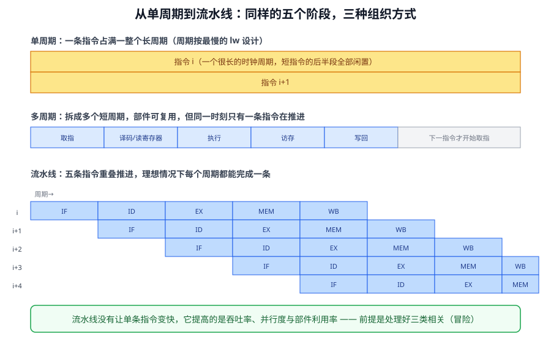
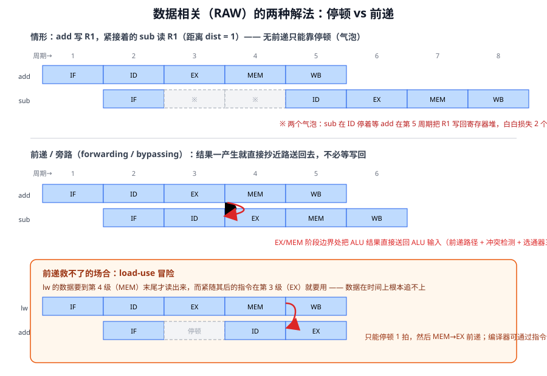
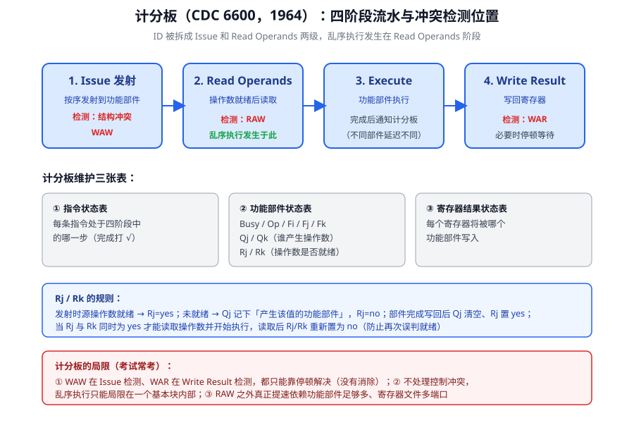

上一讲把单周期处理器搭完了，这一讲回答三个递进的问题：单周期太慢怎么办（多周期）？多周期部件还是闲着怎么办（流水线）？流水线一停全停怎么办（动态调度与计分板）？最后用 64 个周期的完整例子把计分板算法走一遍。

## 1 为什么要多周期处理器

单周期处理器的死穴在于：时钟周期必须容纳**最慢的那条指令**。Load 指令要取指、读寄存器、算地址、访存、写回，一条链串下来，其他所有短指令都被迫陪着用这么长的周期。执行 `add` 时，时钟周期的后半段整个数据通路都在闲置。

CPU 时间 = 指令数 IC × CPI × 时钟周期。IC 由编译器和 ISA 决定，CPI 和时钟周期由处理器实现决定。多周期处理器的思路就是拿 CPI 换周期时间：

- 把指令执行**拆成若干阶段**，每个阶段只做一个独立、简单的事情：一次 ALU 运算、一次访存、一次寄存器存取；
- 时钟周期按**最长的阶段**设置，而不是按最长的指令；
- 不同指令需要的阶段数不同，CPI 不再是 1（Load 大约 5 拍，跳转只要 3 拍），但每一拍都短得多；
- 阶段划分要**均衡**，否则瓶颈又回到最长的那个阶段。

多周期还带来两个结构性好处：**部件复用**——指令和数据共用一个存储器、全机只用一个 ALU（单周期里要有 ALU 加两个加法器），省钱；代价是每个主要功能部件后面都要加**临时寄存器**（IR、MDR、A、B、ALUOut），把上一拍的结果保存到下一拍用。

::: tip 一句话对比
单周期：一条指令一拍完成，时钟慢，部件多，不需要中间寄存器；多周期：一条指令多拍完成，时钟快，部件少，但要加一串临时寄存器。
:::

## 2 多周期的控制器：有限状态机

单周期的控制器是纯组合逻辑——一张真值表，指令译码出控制信号后一用到底。多周期里每条指令要跨越多拍，不同拍要发不同的控制信号，控制器必须"记得自己走到哪一步了"，这就轮到**有限状态机**（FSM）出场。

- **Moore 型**：输出只依赖当前状态。多周期控制采用这种方式，每个状态固定发一组控制信号；
- **Mealy 型**：输出依赖当前状态和输入。

状态组织有个规律：**所有指令的前两个状态完全相同**（取指、译码/读寄存器），之后的分支取决于 opcode——R 型走 ALU 运算路线，Load/Store 走访存路线，beq 走分支路线，j 直接跳。控制器实现上是一个状态寄存器（4 位编码，或用 One-Hot 编码）加一块组合逻辑：由时钟、当前状态和操作码算出下一状态。

## 3 单周期 vs 多周期

| 维度 | 单周期 | 多周期 |
| --- | --- | --- |
| 时钟周期 | 按 Load 最长路径设置 | 按**单个阶段**设置 |
| CPI | 恒为 1 | 各指令不同（>1） |
| 部件 | 指令/数据存储器分开，ALU + 两个加法器 | 一套存储器、一个 ALU，跨拍复用 |
| 中间结果 | 不需要临时寄存器 | 每个部件后加寄存器保存 |
| 控制器 | 组合逻辑 + 真值表（信号全程不变） | 有限状态机（逐拍变化） |

顺手把处理器设计的通用五步骤固化下来，之后的设计都在这个框架里：第一步用 RTL 描述每条指令的功能；第二步据此确定元件和时钟方案；第三步把数据通路互连；第四步汇总所有指令的控制信号取值，列出指令-信号关系表；第五步写出每个信号的逻辑表达式，设计控制器。数据通路里的元件分两类：**操作元件**用组合逻辑实现，**存储（状态）元件**用时序逻辑实现。

## 4 流水线：让所有部件每一拍都忙

单周期里执行短指令时后半段闲置，多周期里也没有任何部件能做到每一拍都忙。流水线的目标是**吞吐率**：一条指令还没走完，下一条就进来了，各级部件同时服务不同的指令。

理想的流水线要满足三个条件：

1. **重复执行相同的操作**——大量输入走同样的流程（像洗衣房，每桶衣服都过同样的工序）；
2. **操作之间相互独立**——没有依赖；
3. **能均匀划分成等延迟的子操作**，且子操作不共享资源。

现实世界先给了一记普适的闷棍：级与级之间要插流水寄存器，它有延迟 S、有成本。k 级流水的吞吐率不是理想的 k/T，而是 **1/(T/k + S)**——级分得越细，寄存器开销占比越大；硬件成本从 G + R 变成 G + kR。所以流水线级数不是越多越好。

指令流水线更是三个条件**全都不满足**：

- 不同指令不需要相同的阶段 → 强行走同一组级，某些级对某些指令是空转的（**外部碎片**）；
- 各级延迟天然不均，却被同一个时钟约束 → 快的级必须陪等（**内部碎片**）；
- 指令之间有依赖 → 必须检测并解决相关，否则结果错误 → **停顿**（stall），流水线不是永远在流动。

于是流水线设计的核心议题清单就出来了：平衡各级工作量；在有相关的情况下让流水线保持正确、流动、充满；处理长延迟（多周期）操作；处理异常与中断。



## 5 三种相关（Hazard）

流水线停下来的场合统称相关/冒险，共三类：**资源相关、数据相关、控制相关**。

### 5.1 资源相关

两条不同级的指令要抢同一个部件。三个典型位置：

- **寄存器堆**：ID 级要读，WB 级要写。解法很优雅——把一个周期劈成两半，**前半拍写、后半拍读**，读写同拍不冲突；代价是寄存器操作只剩半拍时间可用。
- **存储器**：IF 取指令、MEM 取数据都要访存。解法是**指令存储器与数据存储器分开**（这就是哈佛结构在流水线里的意义）。
- **功能部件**：多条指令要用同一个乘法器/除法器。解法是复制部件，或者停顿。

注意结论：**资源冲突只能靠停顿解决**——部件物理上只有一个，谁也变不出来。

### 5.2 数据相关：RAW、WAR、WAW

按读写顺序分三种：

| 类型 | 别名 | 形式 | 性质 |
| --- | --- | --- | --- |
| RAW | 真相关 / 流相关 | 写后读 | **值相关**，必须遵守 |
| WAR | 反相关 | 读后写 | 名字相关 |
| WAW | 输出相关 | 写后写 | 名字相关 |

RAW 是真正的数据依赖：后一条指令要用的值由前一条产生，语义上绕不开。WAR 和 WAW 则不同——它们只是两条指令**碰巧用了同一个寄存器名字**。如果寄存器多到每条指令都能分到独享的寄存器，这两类相关根本不会存在。这个"值相关 vs 名字相关"的区分是后面所有乱序执行技术的伏笔。

处理名字相关有一个简单办法：**只在最后一级、按程序顺序写回**，先读的不会被后写的覆盖，后写的也不会被先写的冲掉。真正麻烦的是 RAW，它有五种处理途径：

1. 检测到相关后**等待**，直到值写回寄存器堆；
2. 在**软件层**消除相关（编译器调度指令，硬件不用检测）；
3. 检测相关并**前送/旁路**（forwarding/bypassing）数据；
4. **预测**需要的值，投机执行，事后验证；
5. 干脆切去执行别的线程（**细粒度多线程**），不需要检测。

### 5.3 控制相关

指令 i 与分支指令之间的相关：i 只能在"应当被执行"的时候才被执行。落到代码移动上就是两条规则：

- 受分支 p 控制的指令，**不能移到 p 之前**、脱离 p 的控制（否则 p 不成立时它也执行了）；
- 不受 p 控制的指令，**不能移到 p 之后**、落进 p 的控制范围（否则 p 不成立时它反而不执行了）。

比如 `if p1 {S1;} if p2 {S2;}` 中，S1 控制依赖于 p1；S2 控制依赖于 p2，但不依赖于 p1——所以 S2 可以移到 p1 的判断之前，却不能越过 p2。

## 6 停顿、联锁与前送

### 6.1 没有前送时要隔多远

5 级流水线（IF ID EX MEM WB），寄存器堆前半拍写后半拍读。生产者 i 的值在第 5 拍写回，消费者 j 最早在第 5 拍的 ID 才能读到新值。往前倒推：j 的 ID = j 进流水后第 2 拍，所以 j 至少要和 i 隔 2 条指令才能完全无停顿；紧挨着（隔 0 条）要插 2 个气泡，隔 1 条要插 1 个气泡。**停顿的本质：让相关指令原地等待，直到源数据可用。**

检测到相关后插入气泡这件事叫**联锁（interlocking）**，有软硬件两条路线：

- **软件联锁**：编译器把指令重排到足够远，实在不行插 NOP 空指令，硬件完全不检测；
- **硬件联锁**：硬件检测相关并自动插入气泡。

MIPS 这个名字本身就是历史注脚：**M**icroprocessor without **I**nterlocked **P**iped **S**tages——早期的 MIPS 把流水线联锁甩给了编译器。

### 6.2 前送：抄近路

等待写回太浪费了。观察一个事实：ALU 算完的结果**在 EX 级末尾就已经存在了**，何必等它绕 MEM、WB 走完两拍再从寄存器堆读？**前送**（forwarding/bypassing）就是在结果产生后第一时间，直接把它送到需要它的功能部件（通常是 ALU，也可能是数据存储器），绕过寄存器堆这条"正路"。

加上 EX→EX 前送后，相邻的两条 ALU 相关指令可以完全无停顿地背靠背执行——前一条 EX 算完，后一条 EX 恰好接住。前送的实现要点有三条：

1. **数据要送回去**（新增旁路总线）；
2. 多路输入要有一个**选通器**（ALU 入口到底是读寄存器堆还是收前送值？）；
3. 要有**冲突检测电路**来控制选通器。



### 6.3 前送救不了 Load-Use

前送不是万能的。`lw` 的数据要等到 **MEM 级结束**才从存储器里拿出来，而紧随其后的指令在下一拍就进入 EX 级——数据还没出生，前送无从谈起。这个场景叫 load-use 相关，无论怎么加前送路径，都**至少要停顿一拍**；如果两条指令隔开一条，前送就能接上。这是指令级并行里著名的"加载延迟槽"问题的根源。

## 7 静态调度：编译器排指令

**指令调度**：在不改变程序执行结果的前提下改变指令顺序，让相互依赖的指令离得足够远，消除冲突或减少停顿。完全靠编译器做调度、硬件严格按程序顺序发射的流水线，就是**静态调度流水线**（顺序发射）。

它有个致命的行为特征：**一条停顿，全线停顿**。看两段代码：

```text
MUL  R3 ← R1, R2        LD   R3 ← R1(0)
ADD  R3 ← R3, R1        ADD  R3 ← R3, R1
ADD  R4 ← R6, R7        ADD  R4 ← R6, R7
MUL  R5 ← R6, R8        MUL  R5 ← R6, R8
ADD  R7 ← R9, R9        ADD  R7 ← R9, R9
```

左边：第二条 ADD 依赖 MUL 的结果（RAW），停顿，后面三条明明独立也全部卡死。右边：换成 LD 之后情况更糟——load 的延迟**要到运行时才知道**（命中还是缺失），编译器只能按最坏情况安排，实际执行中每次 cache miss 都必然转化为停顿。

静态调度的五宗罪，条条指向同一个方向：

1. 对编译器开发者要求太高，必须吃透每款 CPU 的部件数量和延迟；
2. 有些依赖编译时无法确定（比如经由存储器的冲突）；
3. 编译器通用性差，每款 CPU 配一套专用编译器；
4. 代码通用性差，CPU 一换代就要全部重编译；
5. cache miss 必然变成停顿，编译器无法预知哪次 load 会 miss。

出路只有一个：让**硬件**接管调度。

## 8 动态调度：把 ID 拆成两半

动态调度的核心思想一句话：**允许就绪的指令越过前面的停顿指令，率先投入运行**（乱序执行）。"就绪"指没有资源冲突、操作数都已就绪。硬件要负责跟踪停顿指令的状态，一旦就绪立刻发射。收益是**延迟容忍**：长延迟指令堵在路上，别的独立指令照常完成。

改造对象是 ID 级，因为就绪指令恰恰是在 ID 被卡住的。ID 的处境：它**必须按序**（前一条没译码，后一条没法做冲突检测），却在一个按序的阶段里做了**过多的检测**（资源冲突、所有数据相关全在这一级查），任何一项不过关就停顿并连累全线。

解法是把 ID 拆成两级：

- **Issue（发射）**：只做最必要的事——译码、资源冲突检测。仍然按序，在这里停顿的指令照样阻塞后面所有指令；但**不再检测数据相关**，所以不管就绪没就绪，指令都有机会发出去。
- **Read Operands（读操作数）**：在这一级等待数据冲突消除、读取操作数。**乱序执行就发生在这里**——非就绪指令停在这一级，就绪指令直接进入执行。

所有动态调度流水线都要做这个拆分，区别只在于**用什么结构管理那些已发射、未就绪的指令**：计分板算法用计分板，Tomasulo 算法用保留站。

## 9 计分板算法

1964 年的 CDC 6600 是当时世界上最快的计算机，它的核心就是计分板——一个记录全部必要信息、用来控制指令何时可以读操作数并运行、何时可以写结果（原文如此，对应 RAW 与 WAR 的检测）的中央调度机构。WAW 在 Issue 阶段检测，仍会导致整条流水线停顿。

### 9.1 四个阶段与三张表

每条指令经历四个阶段，每段查一类相关：

| 阶段 | 做什么 | 查什么 |
| --- | --- | --- |
| Issue | 功能部件空闲，且没有其他活跃指令写同一目标寄存器，才发射到部件 | 资源冲突、**WAW** |
| Read Operands | 等到两个源操作数都就绪（没有更早的活跃指令要写它们），一次性读入 | **RAW**（乱序由此开始） |
| Execute | 部件执行，完成后通知计分板 | — |
| Write Result | 计分板检查没有更早的指令还要**读**旧值，才允许写回；否则停顿 | **WAR** |

计分板维护三张表：

- **指令状态表**：每条指令在 Issue / RO / EC / WR 四个阶段各一个勾；
- **功能部件状态表**：每个部件一行，字段为 Busy、Op、Fi（目标寄存器）、Fj/Fk（源寄存器）、Qj/Qk（产生 Fj/Fk 的部件名）、Rj/Rk（Fj/Fk 是否就绪且尚未被读）；
- **寄存器结果状态表**：每个寄存器记录将写入它的功能部件（没有则为空）。

Rj/Rk 的状态机规则值得单独立一张卡：

::: tip Qj/Rj 的设置规则
发射时若源操作数 Fj 就绪 → Qj 置空，Rj 置 yes；未就绪 → Qj 置为产生它的部件名，Rj 置 no。当 Fj 就绪后 → Qj 置空，Rj 置 yes。Rj 与 Rk 都为 yes 才能开始执行；功能部件读走操作数后，Rj/Rk 重新置 no。
:::



### 9.2 完整示例：64 个周期

延迟设定：Integer 部件 2 拍、乘法 10 拍、除法 40 拍、加法 2 拍。程序共 6 条指令：

```text
L.D    F6, 34(R2)
L.D    F2, 45(R3)
MUL.D  F0, F2, F4
SUB.D  F8, F6, F2
DIV.D  F10, F0, F6
ADD.D  F6, F8, F2
```

各条指令在四个阶段的落位（数字为周期号）：

| 指令 | Issue | Read Operands | Execute 完成 | Write Result |
| --- | --- | --- | --- | --- |
| L.D F6, 34(R2) | 1 | 2 | 3 | 5 |
| L.D F2, 45(R3) | 6 | 7 | 9 | 10 |
| MUL.D F0, F2, F4 | 7 | 11 | 21 | 22 |
| SUB.D F8, F6, F2 | 8 | 11 | 13 | 14 |
| DIV.D F10, F0, F6 | 9 | 23 | 63 | 64 |
| ADD.D F6, F8, F2 | 15 | 16 | 18 | 24 |

整条流水线在第 64 拍才全部写回。把其中的每个"堵点"拆开看，比背表格有价值得多：

- **第 1~5 拍，资源相关**：第二条 Load 想发射，但 Integer 部件（存储器端口）被第一条 Load 占着，只能干等到第 6 拍。这 4 拍里后面所有指令都无法进入。
- **第 7~10 拍，RAW 在 Read Operands 等待**：MUL.D（等 F2）、SUB.D（等 F2）虽已发射，但操作数没就绪，卡在读操作数级；DIV.D 依赖 MUL.D 的 F0，也发得出去、动不了。到第 10 拍第二条 Load 写回，MUL.D 与 SUB.D 同时就绪，第 11 拍一起读操作数——**两条指令乱序读、并行执行**，这就是动态调度的收益。
- **第 10~14 拍，资源相关再现**：ADD.D 想发射，但 Add 部件正被 SUB.D 占用，只能等 SUB.D 第 14 拍写回后、第 15 拍才发射。
- **第 18~23 拍，WAR 停顿**：ADD.D 第 18 拍就算完了，却**不能写回**——它要写的 F6 正是更早的 DIV.D 还没读走的源操作数。按序写回是计分板保护 WAR 的方式。第 22 拍 MUL.D 写回使 DIV.D 就绪，第 23 拍 DIV.D 读走 F6，第 24 拍 ADD.D 才得以写回。
- **第 24~63 拍，长延迟**：DIV.D 执行整整 40 拍。期间没有任何指令可以插队推进——因为它是最后一条了，乱序调度到了"无序可乱"的边界。

### 9.3 性能分析

计分板证明了乱序执行可行，但两个天花板没有突破：

- **没有处理控制相关**，乱序执行的范围局限于一个基本块之内；
- **WAR/WAW 没有被消除**，只是靠停顿绕过去（上例第 18~23 拍的 WAR 停顿就是现场证据）。

消除 WAR/WAW 要换一个根本思路——不改变写入顺序也能保证正确，关键是维持正确的**数据流**。这正是下一讲 Tomasulo 算法的起点。

## 10 小结

- 单周期的时钟被最慢指令绑架；多周期拆阶段、加临时寄存器、部件复用，用 Moore 型 FSM 做逐拍控制。
- 流水线追求吞吐率，但寄存器开销（1/(T/k+S)）限制级数，三类不理想（阶段不齐、延迟不均、指令相关）带来停顿。
- 相关分资源/数据/控制三类；数据相关里 RAW 是值相关、WAR/WAW 是名字相关，这个区分决定了它们的处理难度天差地别。
- 资源冲突只能停顿；RAW 可以等待、软件消除、前送、投机、多线程五路处理；前送救不了 load-use。
- 静态调度把包袱甩给编译器，一条停顿全线停顿；动态调度把 ID 拆成 Issue + Read Operands，乱序在读操作数一级发生。
- 计分板四阶段各查一类相关（Issue 查资源与 WAW、RO 查 RAW、WR 查 WAR），三张表维护全局状态，64 拍示例里资源冲突、RAW 等待、WAR 停顿轮番登场。

## 自测

1. 单周期和多周期的时钟周期分别由什么决定？多周期为什么必须增加临时寄存器？
2. 多周期控制器为什么用 Moore 型 FSM？哪些状态是所有指令共享的？
3. 流水线的三个理想条件是什么？指令流水线分别在哪一条上不满足？
4. 寄存器堆的读写冲突如何在不加停顿的情况下解决？代价是什么？
5. RAW、WAR、WAW 分别是什么？为什么说后两类是"名字相关"？
6. 前送的三个实现要点是什么？为什么 load-use 相关至少要停一拍？
7. MIPS 这个缩写的全称是什么？它反映了哪种联锁策略？
8. 动态调度为什么要拆分 ID？拆出的两个阶段各做什么、是否按序？
9. 计分板的四个阶段各检测什么相关？Qj、Rj 字段的含义与状态转换规则是什么？
10. 在 64 拍示例中，ADD.D 为什么第 15 拍才能发射、第 18 拍完成后又等了 6 拍才写回？

## 参考资料

- 《计算机体系结构：量化研究方法》（中文版第六版），Hennessy & Patterson
- Smith & Sohi, "The Microarchitecture of Superscalar Processors," Proceedings of the IEEE, 1995. <https://ieeexplore.ieee.org/document/371275>
- McFarling, "Combining Branch Predictors," DEC WRL Technical Report, 1993. <https://www.hpl.hp.com/techreports/Compaq-DEC/WRL-TN-36.pdf>
- Kessler, "The Alpha 21264 Microprocessor," IEEE Micro, 1999. <https://ieeexplore.ieee.org/document/755465>
- ETH Zürich, Onur Mutlu, Computer Architecture 课程讲义. <https://safari.ethz.ch/architecture/>
- 国科大《计算机体系结构》课程 PPT（第 3 讲：复杂流水线和乱序执行·中）
