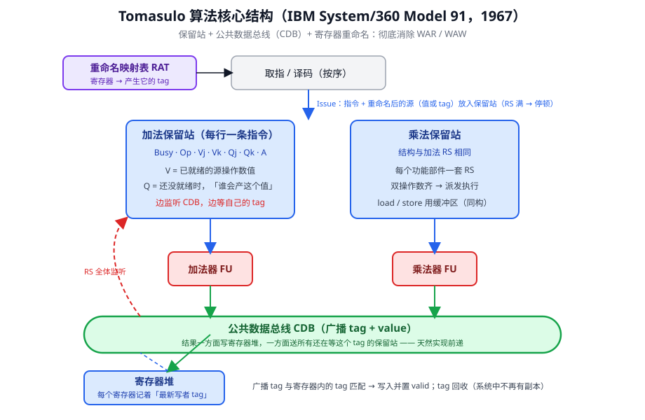
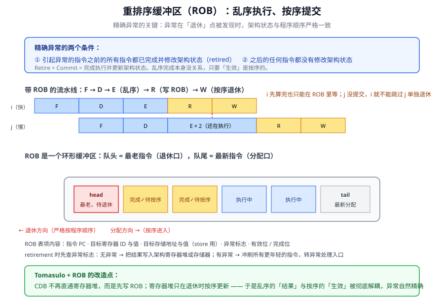
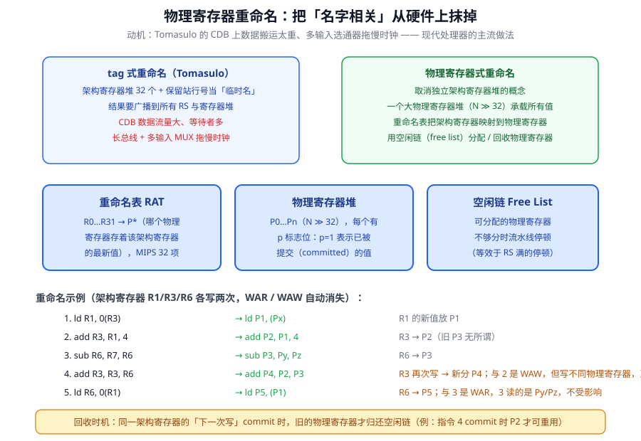

计分板证明了乱序执行可行，但 WAR/WAW 还要靠停顿硬扛。这一讲的 Tomasulo 算法换了一个釜底抽薪的思路：既然名字相关源于寄存器名字不够用，那就**重命名**。再加上重排序缓冲（ROB）解决精确异常、物理寄存器堆取代保留站 tag，现代乱序处理器的三大件就齐了。

## 1 Tomasulo：给每个值一个 tag

1964 年 IBM 推出 System 360/91，Robert Tomasulo 为它设计的浮点乱序执行机制就是 Tomasulo 算法（论文发表于 1967 年的 IBM Journal of R&D）。它的核心是**寄存器重命名**，通过重命名**彻底消除 WAR/WAW 冲突**——计分板里这两类相关靠停顿，在这里直接消失。

乱序执行要解决的根本问题是：在值的**生产者**和**消费者**之间建立通信。Tomasulo 的通信协议可以浓缩成五句话：

1. 给每个待产生的值发一个 **tag**（唯一名字）；
2. 指令发射后进**保留站**缓冲，操作数要么直接带上值，要么带上 tag；
3. 保留站**持续监听**公共数据总线，等值的生产；
4. 值一算完，生产者就把自己的 tag **广播**到总线上，所有保留站拿自己的 tag 去匹配，匹配上就取值；
5. 操作数凑齐的指令分发到功能单元执行，算完再仲裁总线广播——循环往复。

支撑这套协议的是三件套：

| 组件 | 职责 |
| --- | --- |
| **保留站**（Reservation Station，调度窗口） | 按功能部件分组（load/store 缓冲器结构与之基本相同）；每行缓存一条已发射的指令及其操作数 |
| **公共数据总线**（CDB） | 广播已完成指令的 ⟨tag, 值⟩；不仅送寄存器堆，也送给所有在等待的保留站——**相当于内置了前送**，RAW 靠它解决 |
| **寄存器别名表**（RAT，重命名映射表） | 每个架构寄存器一项：有效位为 1 时值正确；为 0 时 tag 指出"正确值将由谁产生" |

保留站每一行的字段：**Busy**（是否占用）、**Op**（操作类型）、**Vj/Vk**（已就绪的源操作数值）、**Qj/Qk**（产生该操作数的保留站编号，为 0 表示值已在 Vj/Vk 中）、**A**（load/store 的地址计算信息）。指令按序发射到保留站；保留站全满时无法发射，只能停顿。



## 2 WAR/WAW 是怎么消失的

### 2.1 消除 WAR

场景：指令 i 读 R1 和 R3，其中 R3 还没就绪；后面的指令 j 要写 R1。

- **计分板的做法**：i 迟迟不开始执行，R1 也就一直没被读走，j 想写 R1 只能停顿——写回级按序检查 WAR，等的就是这种时刻。
- **Tomasulo 的做法**：i 发射时**立即把就绪的 R1 取走**，存进保留站的临时位置 s。i 之后引用的是 s 而不是 R1，于是 j 执行完可以立刻写 R1，谁也不挡谁。源操作数寄存器等于被悄悄重命名了。

### 2.2 消除 WAW

场景：指令 I 写 R3，后面的指令 J 读 R3，再后面 K 写 R3、M/N 读 R3。

关键洞察：**要维持的是正确的数据流，而不是写入顺序**——只要 J 读到的是 I 的结果、M/N 读到的是 K 的结果，I 和 K 谁先完成根本无所谓。计分板在发射级检测 WAW 让流水线整体停顿，恰恰是被"写入顺序"绑住了。

Tomasulo 的做法：J 发射后，不仅立即取走就绪的操作数，还为未就绪的 R3 **预留一个临时位置并贴上标签 ⟨I⟩**（I 所在保留站的行号），建立起"这个值由 I 生产"的关联。I 执行完毕后，结果一方面写入 R3，另一方面广播给所有贴着 ⟨I⟩ 标签的临时位置。J 拿到的一定是 I 的值，K 何时覆盖 R3 与 J 无关。

## 3 算法流程

把整个生命周期串起来：

1. **发射（重命名）**：保留站有空位才发射，否则停顿。发射时查 RAT：源操作数有效就直接带值进站，无效就带 tag；目标寄存器重命名为本保留站行的 tag，写入 RAT。
2. **等待**：在保留站里监听 CDB，广播的 tag 与自己记录的 tag 一致就捕获值。
3. **分发**：两个操作数都就绪的指令进入对应功能单元——**这一步乱序**。
4. **写回**：功能单元算完后仲裁 CDB，广播 ⟨tag, 值⟩。
5. **更新与回收**：寄存器堆挂在 CDB 上，每个寄存器记住"最新写入者的 tag"，广播 tag 与之匹配才写入并置有效位；同时回收重命名 tag——此后系统中不再有该 tag 的有效副本。

## 4 二十拍完整示例

MUL 6 拍、ADD 4 拍，ADD 与 MUL 部件各有独立的保留站和 tag 总线。初始时所有保留站空闲、所有寄存器有效。程序 6 条：

```text
1. MUL  R1, R2 → R3
2. ADD  R3, R4 → R5
3. ADD  R2, R6 → R7
4. ADD  R8, R9 → R10
5. MUL  R7, R10 → R11
6. ADD  R5, R11 → R5
```

逐条指令的关键时间点（RS 一列是重命名后实际占用的保留站行）：

| # | 指令 | RS | 发射/重命名 | 开始执行 | 完成并广播 | 寄存器堆写入 |
| --- | --- | --- | --- | --- | --- | --- |
| 1 | MUL R1,R2→R3 | x | 第 2 拍，R3→x | 第 3 拍 | 第 8 拍 ⟨x, 2⟩ | 第 8 拍 R3=2 |
| 2 | ADD R3,R4→R5 | a | 第 3 拍，R5→a，源 1 带 tag x | 第 9 拍 | 第 12 拍 ⟨a, 6⟩ | **不写入**（R5 已指向 d） |
| 3 | ADD R2,R6→R7 | b | 第 4 拍，R7→b | 第 5 拍 | 第 8 拍 ⟨b, 8⟩ | 第 8 拍 R7=8 |
| 4 | ADD R8,R9→R10 | c | 第 5 拍，R10→c | 第 6 拍 | 第 9 拍 ⟨c, 17⟩ | 第 9 拍 R10=17 |
| 5 | MUL R7,R10→R11 | y | 第 6 拍，R11→y，两源带 tag b、c | 第 10 拍 | 第 15 拍 ⟨y, 136⟩ | 第 15 拍 R11=136 |
| 6 | ADD R5,R11→R5 | d | 第 7 拍，R5→d，两源带 tag a、y | 第 16 拍 | 第 19 拍 ⟨d, 142⟩ | 第 20 拍 R5=142 |

几个决定性瞬间值得放大：

- **第 2 拍**：MUL 进保留站 x，查 RAT 发现 R1、R2 都有效，两个值直接进站；R3 重命名为 x。x 的两个操作数都齐了，下一拍就能执行。
- **第 5、6 拍，乱序发生**：第 3、4 条 ADD 与第一条 MUL 毫无依赖，虽然排在它后面，却在它算完之前（第 8 拍）就先后进入加法器执行。第 2 条 ADD 则因为源 1 带着 tag x，在站里安静等待。
- **第 8 拍，CDB 广播**：MUL 完成，广播 ⟨x, 2⟩。保留站 a 匹配到自己的源 tag，捕获 2，立刻就绪；寄存器堆里 R3 的 tag 恰好也是 x，写入 2 并置有效位。同一拍，第 3 条 ADD 也完成并广播 ⟨b, 8⟩。**两条总线同时工作，这就是 ADD 与 MUL 分设 tag 总线的意义。**
- **第 7 拍与第 12 拍，WAW 被消灭的现场**：第 6 条指令的目标是 R5，而 R5 已经被第 2 条指令重命名成 a——没关系，再重命名一次变成 d。第 12 拍 a 广播 ⟨a, 6⟩ 时，RAT 里 R5 已经指向 d，寄存器堆对 tag a 的广播**不予理会**；6 只被保留站 d 捕获当作源操作数。最终 R5 只接收第 19 拍 d 广播的 142（=6+136）。两次写同一寄存器，既没有停顿，也没有错序覆盖。
- **第 10~15 拍，RAW 链**：第 5 条 MUL 等 b、c 两个 tag 先后广播凑齐操作数（8×17=136），从第 10 拍开始执行 6 拍；第 6 条 ADD 再等 a、y 凑齐，第 16 拍执行 4 拍，第 20 拍 R5 写入 142，全剧终。

注意观察每一处"等待"发生的位置：指令 2 等 x、指令 5 等 b/c、指令 6 等 a/y，全部等在**保留站**里，流水线的取指译码照常流动——发射之后的等待不再阻塞任何别的指令（只要它们自己就绪）。对比计分板示例里"一条停顿、全线停顿"，这就是保留站作为**调度窗口**的价值。

## 5 性能分析与遗留问题

Tomasulo 把数据冲突处理得干净利落，与分支预测、猜测执行配合后能压榨出很高的性能，至今仍是主流处理器的骨架。但两个短板在同一讲里必须点破：

- **控制冲突依旧没有处理**，乱序执行的范围仍局限在一个基本块内；
- **性能受限于 CDB**：所有结果都要过这条总线，数据搬运量大，多输入的多路选择器和长总线直接拖累时钟频率。

还有一个更隐蔽的问题在第 20 拍之后浮现：六条指令**乱序完成、乱序更新架构状态**——R3、R7、R10、R11 在各自算完的当拍就写入了寄存器堆。一切顺利时这很高效，可一旦中途某条指令触发异常、或者分支预测错了要回滚，已经写进去的状态根本**无法按程序序撤销**。这就引出本讲的后半场：精确异常。

## 6 不精确异常与精确异常

### 6.1 异常从哪来

CPU 执行中被"打断"的事件分两类：**内部异常**——CPU 内部的意外或特殊事件，包括硬故障中断（掉电、线路故障）和程序性中断（算术溢出、缺页、越界、越权、非法指令、除数为 0、堆栈溢出、超时、断点、单步、系统调用等）；**外部中断**——CPU 之外的事件通过中断请求信号打进来（实时钟、控制台、外设就绪、DMA 传输结束等）。通常"异常"泛指控制流的任何意外改变，"中断"特指外部事件。

处理流程上，CPU 周而复始执行指令，执行中发现异常就立即转入处理（或先记录原因，留到指令最后阶段再处理）；每条指令结束时查询有无中断请求，有则响应。

### 6.2 乱序为什么破坏精确性

指令执行时间不同（整数加法 1 拍、浮点乘法多拍、除法更长），流水线自然想让长延迟指令去专用部件慢慢算、别的指令先走。但这样 ISA 的**顺序语义**就被破坏了：`DIV R2←R5,R6` 在前、`ADD R7←R5,R6` 在后，ADD 先写回；此时如果 DIV 触发异常，处理器呈现的状态与两条指令严格按序执行时的状态**并不相同**——要么异常点之后的指令已经改了状态，要么异常点之前的指令还没改完。这就是**不精确异常**。

精确异常的定义只有两条，异常准备好被处理的那一刻：

1. 所有**更早**的指令已经完全退休；
2. **没有任何更晚**的指令退休。

（Retire = Commit = 完成执行并更新架构状态。）

为什么要较这个真？因为精确异常是程序语义与硬件行为对齐的基石：调试器才能准确定位出错指令；操作系统才能从异常点恢复、重新启动进程；TRAP 这类用软件操作码触发的系统调用才能被干净地管理。

### 6.3 处理流程与解决方案

当**最老的、已就绪待退休的**指令被检出异常时，控制逻辑做四件事：保证架构状态（寄存器堆、PC、存储器）精确；冲刷所有更年轻的指令；按 ISA 规定保存 PC 和寄存器；把取指重定向到异常处理例程。

保证精确异常的方案有一打，各提一个思路：

- **顺序化**：所有指令统一按最坏情况的延迟执行——精确性天然成立，但最坏延迟绑架一切，访存操作根本没法统一，实际不可行；
- **重排序缓冲（ROB）**——主流方案，下一节展开；
- 历史缓冲（History Buffer）、未来寄存器文件（Future Register File）、检查点（Checkpointing）——思路各异，ROB 胜出成为事实标准。

## 7 重排序缓冲（ROB）

### 7.1 思想：完成可以乱，提交必须按序

ROB 的想法是在"指令算完"和"更新架构状态"之间插一道**按程序序排队的闸门**：

- 指令**完成**时：结果先写进 ROB（同时更新 RAT，此时 RAT 相当于一个"前端寄存器文件"）；
- 指令**退休**时：轮到它是机器里最老的、且已完成，才把结果从 ROB 写入独立的架构寄存器堆（或存储器）——架构状态**永远按程序序更新**；
- 异常发生时：冲刷流水线，用架构寄存器堆的内容恢复前端，一切年轻指令的半成品作废。

ROB 是一个**循环缓冲**：头端是最老的指令，尾端接新指令，表项跟着指令按发射顺序依次入队、按同样顺序从头部退休。表项里装的是正确重排和异常恢复所需的一切：

- 指令 PC（异常时指明出错位置）；
- 异常标志位；
- 目标寄存器 ID 与值；
- 目标存储器地址与数据（store 指令用）；
- 各种有效位/控制位（结果是否就绪、指令是否完成等）。

带 ROB 的流水线变成 F-D-E-R-W 五段：**D**（译码时访问寄存器堆与 ROB、分配 ROB 表项、可以执行就分发）、**E**（乱序执行、乱序完成）、**R**（Completion，结果写入 ROB）、**W**（Retirement，检查异常：无则写架构寄存器堆或内存，有则冲刷流水线转异常处理程序）。概括成一句话：**顺序发射、乱序完成、顺序退休**。



### 7.2 Tomasulo + ROB

两者是无缝拼装：CDB 不再直通寄存器堆，改道**直通 ROB**——完成的结果先落 ROB，退休时再进架构状态。原始 Tomasulo"算完即写寄存器堆"导致的不精确性被彻底治愈。

剩下一个小工程问题：消费者去哪找还没退休的值？值可能躺在寄存器堆、ROB 或前送路径三处。朴素做法是把 ROB 做成**按内容寻存的 CAM**：拿着寄存器 ID 逐项比对每个表项，还得在多条指令写同一寄存器时挑出最老的那个——又贵又慢。简化办法是**间接寻址**：先查寄存器堆，若无效，寄存器堆里存的正是持有（或将持有）该值的 ROB 表项指针，顺着指针直达；ROB 从此退化为普通 RAM。

## 8 物理寄存器重命名

### 8.1 从"tag"到"物理寄存器"

Tomasulo 的重命名用的名字是**保留站行号**（缓冲区 tag），值的家还是架构寄存器堆。这个方案的天花板正是 CDB：所有数据在总线上搬来搬去。换一种重命名就绕开了它：

- **取消架构寄存器堆**，改用一个**大得多的物理寄存器堆**（N ≫ 32 个，P0…Pn）；
- 重命名映射表把**架构寄存器**（如 R0–R31）映射到**物理寄存器**；
- 增加**空闲表**（Free List）管理尚未分配的物理寄存器。

两种重命名实现的对照——本质都是"把值的生产者和消费者解耦"，只是名字不同：

| | tag 重命名（Tomasulo） | 物理寄存器重命名 |
| --- | --- | --- |
| 新名字是 | 保留站行号 | 物理寄存器编号 |
| 值存放处 | 保留站 | 物理寄存器堆 |
| 名字何时回收 | 广播后 tag 失效 | 同一架构寄存器的下一次写**提交**时 |

### 8.2 生命周期与管理

每条指令的目标架构寄存器都被重命名为一个新物理寄存器。以 8 条指令的程序为例（左列架构寄存器，右列物理寄存器）：

```text
1. ld  R1,(R3)     ld  P1,(Px)
2. add R3,R1,4     add P2,P1,4
3. sub R6,R7,R9    sub P3,Py,Pz
4. add R3,R3,R6    add P4,P2,P3
5. ld  R6,(R1)     ld  P5,(P1)
6. add R6,R6,R3    add P6,P5,P4
7. st  R6,(R1)     st  P6,(P1)
8. ld  R6,(R11)    ld  P7,(Pw)
```

物理寄存器的**重用时机**是精髓：当同一架构寄存器的**下一次写提交**时，旧物理寄存器才能回收——例中 P2 是指令 2 写 R3 的家，指令 4 再次写 R3；等指令 4 提交，再没有任何指令引用 P2，它才回到空闲表。回收过早，读旧值的指令就拿到脏数据。

三个管理部件各司其职：

- **重命名映射表**：架构寄存器 → 物理寄存器。MIPS 有 32 个架构寄存器，表就 32 项；物理寄存器可以有几百个；
- **物理寄存器堆**：N ≫ 32 个寄存器，p 标志置位表示其中是已提交的数据；
- **空闲表**：可分配的物理寄存器清单。发射时从这里取新寄存器；**物理寄存器不足时流水线停顿**——这是物理寄存器方案下独有的资源性停顿。

### 8.3 五条指令的重命名走一遍

```text
1. ld  R1, 0(R3)
2. add R3, R1, 4
3. sub R6, R7, R6
4. add R3, R3, R6
5. ld  R6, 0(R1)
```

逐条看发射时的动作（每条指令在 ROB 里有一行，记着 PR1/PR2 两个源物理寄存器及就绪位、目标 Rd、新目标 PRd、旧目标 LPRd）：

1. **ld R1,0(R3)**：源 R3 按映射表当前指向取值；从空闲表取出 P0 作为 R1 的新物理寄存器，R1 的旧寄存器记入本行 LPRd。
2. **add R3,R1,4**：源 1 是 P0——注意，用的是**上一条刚分配的 P0**，数据流立刻对上；R3 重命名为 P1。
3. **sub R6,R7,R6**：源 1、源 2 分别是 R7、R6 当前的物理寄存器；R6 重命名为 P3。
4. **add R3,R3,R6**：源 1 是 P1（指令 2 刚写的那个 R3），源 2 是 P3；R3 重命名为 P2，旧目标 P1 记入 LPRd。
5. **ld R6,0(R1)**：源是 P0；R6 重命名为 P4，旧目标 P3 记入 LPRd。



指令提交时，其 LPRd 指向的旧物理寄存器归还空闲表，物理寄存器的 p 标志置位。WAW 在这里体现得明明白白：指令 2 与指令 4 都写 R3，却分别落在 P1、P2 两个物理寄存器里，各写各的，互不干扰，也不用停顿。

## 9 小结

- Tomasulo 用 tag + 保留站 + CDB 建立生产者-消费者通信：发射时带值或带 tag、监听总线、凑齐即发、算完广播、tag 匹配者取值。
- WAR 消除靠"发射即取走就绪操作数"；WAW 消除靠"为目标值预留贴标签的临时位置"，本质是维护数据流而非写入顺序。
- 20 拍示例的三个看点：独立指令乱序先执行、CDB 广播即前送、R5 两次重命名后旧广播被寄存器堆的 tag 校验挡住。
- 短板：控制冲突没管、性能受限于 CDB、乱序更新架构状态导致异常不精确。
- 精确异常 = 异常待处理时，更早的指令全部退休、更晚的一条也没退休；ROB 用"顺序发射、乱序完成、顺序退休"实现它，CDB 改道直通 ROB。
- 物理寄存器重命名用大寄存器堆 + 重命名映射表 + 空闲表取代保留站 tag；物理寄存器在"同一架构寄存器的下一次写提交"后回收，物理寄存器耗尽是一种新的停顿原因。

## 自测

1. Tomasulo 解决生产者-消费者通信的完整协议是什么？tag 由谁分配、在什么场合广播？
2. 保留站一行有哪些字段？Qj 为 0 代表什么？
3. 分别描述 Tomasulo 消除 WAR、WAW 的机制，并说明计分板在同样场景下为什么只能停顿。
4. 寄存器堆为什么只接受与自身 tag 匹配的广播？这个校验在示例里挡住了什么错误？
5. CDB 为什么既解决了 RAW 又成为性能瓶颈？
6. 精确异常的两条定义是什么？为什么乱序执行天然产生不精确异常？
7. ROB 表项里必须保存哪些信息？各服务于什么场景？
8. "顺序发射、乱序完成、顺序退休"中，哪一段发生异常检查？
9. Tomasulo+ROB 之后，消费者如何定位一个尚未退休的值？为什么要避免把 ROB 做成 CAM？
10. 物理寄存器的重用时机是什么？回收过早会发生什么？物理寄存器方案引入了哪种新的停顿？

## 参考资料

- Tomasulo, "An Efficient Algorithm for Exploiting Multiple Arithmetic Units," IBM Journal of R&D, 1967. <https://ieeexplore.ieee.org/document/5392028>
- Smith & Pleszkun, "Implementing Precise Interrupts in Pipelined Processors," IEEE Trans. on Computers, 1988. <https://ieeexplore.ieee.org/document/5015>
- Smith & Sohi, "The Microarchitecture of Superscalar Processors," Proceedings of the IEEE, 1995. <https://ieeexplore.ieee.org/document/371275>
- Hwu & Patt, "Checkpoint Repair for Out-of-order Execution Machines," ISCA, 1987. <https://dl.acm.org/doi/10.1145/30350.30375>
- Cooper & Torczon, "Engineering a Compiler (Second Edition)," Elsevier, 2012，Chapter 12.
- 《计算机体系结构：量化研究方法》（中文版第六版），Hennessy & Patterson
- ETH Zürich, Onur Mutlu, Computer Architecture 课程讲义. <https://safari.ethz.ch/architecture/>
- Duke University, ECE 552 / CPS 550, Advanced Computer Architecture I (Benjamin Lee). <https://www.seas.upenn.edu/~leebcc/class/class_ece252fall12.html>
- 国科大《计算机体系结构》课程 PPT（第 4 讲：复杂流水线和乱序执行·下）
